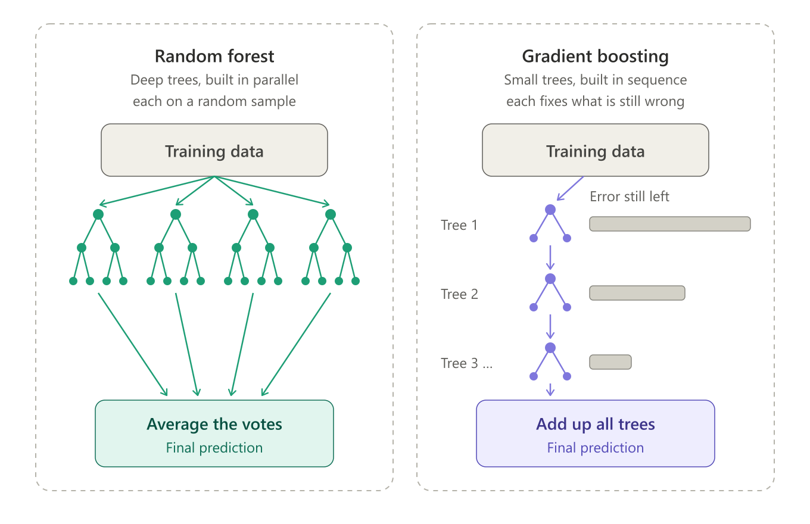

```{r setup, include=FALSE}
knitr::opts_chunk$set(echo = TRUE, message = FALSE, warning = FALSE)
```

# The concept

## Boosting vs random forest

* **Random forest:** many **deep, independent** trees grown **in parallel**,
  then averaged.
* **Boosting:** many **small** trees grown **one after another**. Each new
  tree focuses on the errors the previous trees still make.

Analogy: a team of students correcting an essay. Student 1 writes a rough
draft. Student 2 fixes only what's still wrong. Student 3 fixes what's still
wrong after that, and so on. Each correction is small, but together they
produce a very good essay.

{width=100%}

**"Gradient"** boosting means each tree is fitted to the *gradient* of the
loss: in plain words, to the direction in which the current predictions are
most wrong.

**XGBoost** ("eXtreme Gradient Boosting"; Chen & Guestrin, 2016) is a fast,
regularized implementation that has won many prediction competitions on
tabular data.

## The hyperparameters that matter

| Hyperparameter (tidymodels name) | XGBoost name | Meaning | Typical range |
|---|---|---|---|
| `trees` | `nrounds` | Number of trees added in sequence | 100–2000 |
| `learn_rate` | `eta` | How much each tree's correction counts. Small = slow but careful | 0.001–0.3 |
| `tree_depth` | `max_depth` | Size of each tree. Small = simple interactions | 1–6 |
| `min_n` | `min_child_weight` | Minimum data in a leaf. Larger = more conservative | 1–30 |
| `sample_size` | `subsample` | Share of patients used for each tree (adds randomness) | 0.5–1 |

**Trade-off:** a small `learn_rate` needs many `trees`. Boosting **can
overfit** if it runs too long with too high a learning rate, which is why we
tune these together with cross-validation.

# Load packages and data

```{r packages}
library(tidyverse)
library(tidymodels)
tidymodels_prefer()

heart_split <- readRDS("data/heart_split.rds")
heart_train <- training(heart_split)
heart_test  <- testing(heart_split)

set.seed(2024)
heart_folds <- vfold_cv(heart_train, v = 10, strata = disease)

heart_metrics <- metric_set(roc_auc, brier_class, accuracy, sensitivity, specificity)
```

# The recipe: XGBoost needs numbers only

XGBoost only accepts numbers, so categories must become **dummy (0/1)
columns**. It **handles missing numeric values by itself**: at every split it
learns which direction missing values should go. So we only fill in missing
*categories* (before making dummies) and leave missing numbers as they are.

```{r recipe}
xgb_recipe <- recipe(disease ~ ., data = heart_train) |>
  step_impute_mode(all_nominal_predictors()) |>   # fill missing categories (e.g. thal)
  step_dummy(all_nominal_predictors())            # categories to 0/1 columns. No scaling needed for trees
```

# Model specification with tuning

```{r xgb-spec}
xgb_spec <- boost_tree(
  trees       = tune(),
  tree_depth  = tune(),
  learn_rate  = tune(),
  min_n       = tune(),
  sample_size = 0.8        # fixed: each tree sees a random 80% of patients
) |>
  set_engine("xgboost") |>
  set_mode("classification")

xgb_wf <- workflow() |>
  add_recipe(xgb_recipe) |>
  add_model(xgb_spec)
```

## Set sensible search ranges

The default ranges are very wide, so we narrow them to values that make sense
for small tabular data.

```{r xgb-params}
xgb_params <- xgb_wf |>
  extract_parameter_set_dials() |>             # the list of parameters marked tune()
  update(                                      # change their search ranges:
    trees      = trees(range = c(100, 1000)),
    tree_depth = tree_depth(range = c(1, 6)),
    learn_rate = learn_rate(range = c(-3, -0.5)),  # on log10 scale: 0.001 to 0.32
    min_n      = min_n(range = c(2, 30))
  )

xgb_params
```

## Space-filling grid

### The problem: too many combinations

We want to try different **combinations** of the 4 hyperparameters and keep
the best one. The obvious approach is a **regular grid**: pick 5 values for
each hyperparameter and try every combination. With 4 hyperparameters that is
5 × 5 × 5 × 5 = **625 combinations**, and each one is fitted 10 times (once
per cross-validation fold): **6,250 models**. Far too slow.

So we can only afford a small number of combinations, here **30**. The
question is *which* 30.

### An analogy: placing smoke detectors

Imagine you have 30 smoke detectors for a large hall and you want any fire,
anywhere, to be detected quickly.

* **Regular grid:** neat rows and columns. Tidy, but each detector shares its
  "row" and "column" with many others, so you only cover a few distinct
  positions along each wall.
* **Random:** throw them in from the door. Some land in clumps, and whole
  corners stay empty.
* **Space-filling:** place each detector as far as possible from the others.
  Every part of the hall is covered, and no two detectors waste effort on the
  same spot.

A **space-filling grid** does the same for hyperparameters: it spreads the
combinations evenly across the whole search space.

### See it with two hyperparameters

Here are 25 combinations of just two hyperparameters (learning rate and
minimum node size), chosen in the three ways. The small tick marks along each
axis (a *rug*) show every distinct value that was tried.

```{r grid-demo, fig.height=3.8, fig.width=10}
# A set of only two hyperparameters, with the same ranges we use for XGBoost
two_params <- parameters(
  learn_rate(range = c(-3, -0.5)),   # learning rate from 0.001 to 0.32 (log10 scale)
  min_n(range = c(2, 30))            # minimum node size from 2 to 30 patients
)

set.seed(2024)   # random and space-filling designs involve randomness: fix it

# Build 25 combinations in three different ways and stack them in one table
demo_grids <- bind_rows(
  "Regular grid (5 × 5)" = grid_regular(two_params, levels = 5),        # 5 values each, all combinations
  "Random"               = grid_random(two_params, size = 25),          # 25 random points
  "Space-filling"        = grid_space_filling(two_params, size = 25),   # 25 evenly spread points
  .id = "method"                     # new column saying which method made each row
) |>
  mutate(method = factor(method, levels = c("Regular grid (5 × 5)", "Random", "Space-filling")))  # panel order

ggplot(demo_grids, aes(x = learn_rate, y = min_n)) +
  geom_point(size = 2.5, colour = "steelblue") +                # one dot = one combination to try
  geom_rug(colour = "grey40", length = unit(0.04, "npc")) +     # tick marks: distinct values on each axis
  scale_x_log10() +                                             # learning rate on a log scale
  facet_wrap(~ method) +                                        # one panel per method
  labs(x = "Learning rate (log scale)", y = "Minimum node size (min_n)") +
  theme_minimal() +
  theme(panel.border = element_rect(fill = NA, colour = "grey80"))
```

Now count how many **different** values of each hyperparameter were tried:

```{r grid-demo-count}
demo_grids |>
  group_by(method) |>                              # separately for each method
  summarise(
    different_learn_rates = n_distinct(learn_rate),   # n_distinct() counts unique values
    different_min_n       = n_distinct(min_n)
  )
```

**Why this matters.** Often one hyperparameter barely affects performance.
If, say, `min_n` turns out not to matter, the regular grid has effectively
tested only **5** learning rates: its 25 fits were mostly repeats. The random
design leaves gaps and clumps. The space-filling design tested **25 different
values of each** hyperparameter with the same 25 fits, and covers the space
evenly. With 4 hyperparameters the advantage is even larger.

### The real grid: 30 combinations of 4 hyperparameters

```{r xgb-grid}
set.seed(2024)                         # makes the space-filling layout reproducible
xgb_grid <- grid_space_filling(
  xgb_params,                          # the 4 hyperparameters and their ranges (chunk above)
  size = 30                            # how many combinations ("candidate models") to try
)

xgb_grid   # one row per candidate model, one column per hyperparameter (first 10 rows shown)
```

### Tuning: test every candidate with cross-validation

Each of the 30 candidates is trained and evaluated on all 10 folds: 300 fits
in total. This is the slow step (about a minute).

```{r xgb-tune}
xgb_tune <- tune_grid(
  xgb_wf,                    # the workflow: recipe + XGBoost model with tune() placeholders
  resamples = heart_folds,   # the same 10 cross-validation folds used in every lesson
  grid      = xgb_grid,      # the 30 candidate combinations to try
  metrics   = heart_metrics  # what to measure for each candidate on each fold
)
```

```{r xgb-tune-plot, fig.height=6, fig.width=10}
autoplot(xgb_tune, metric = "roc_auc")   # one panel per hyperparameter; each dot = one candidate's mean AUC
```

**How to read the plot:** each panel shows one hyperparameter on the x-axis.
Each dot is one of the 30 candidates, placed at its value of that
hyperparameter, with its average cross-validated AUC on the y-axis. Look for
**patterns**: for example, whether AUC drops at very high learning rates.
Because all 4 hyperparameters vary at once, expect scatter; no single panel
tells the whole story.

```{r xgb-best}
show_best(xgb_tune, metric = "roc_auc", n = 5)         # the 5 candidates with the highest mean AUC
best_xgb <- select_best(xgb_tune, metric = "roc_auc")  # keep only the single best combination
best_xgb                                               # its 4 hyperparameter values (+ an ID, .config)
```

# Final model and test-set evaluation

Tuning used **only the training data** (through cross-validation) to choose
the hyperparameters. Now three steps finish the job:

1. **Finalize:** replace each `tune()` placeholder in the workflow with the
   value chosen above.
2. **Fit once:** train that final model on **all 227 training patients**.
3. **Test once:** predict the **76 test patients**, who were never used for
   anything until now, and measure performance.

`last_fit()` does steps 2 and 3 in one call.

```{r xgb-final}
xgb_final_wf <- finalize_workflow(   # step 1: fill in the tune() placeholders
  xgb_wf,                            #   the workflow that still contains tune()
  best_xgb                           #   the best combination found by cross-validation
)

xgb_final_wf   # check: the model section now shows real numbers instead of tune()

xgb_final <- last_fit(               # steps 2 and 3: fit on training data, predict the test data
  xgb_final_wf,                      #   the finalized workflow
  split   = heart_split,             #   the original 75/25 split: knows which patients are train/test
  metrics = heart_metrics            #   the same five metrics as before
)

collect_metrics(xgb_final)           # performance on the 76 test patients (look at .estimate)
```

**How to read the output:** each row is one metric. `.estimate` is the value
on the test set. Compare it with the cross-validated value from `show_best()`
above: a test AUC a bit lower than the CV AUC is normal (we picked the best of
30 candidates, which is slightly optimistic, and 76 patients is a small test
set). A **much** lower test AUC would suggest overfitting.

```{r xgb-roc, fig.height=4, fig.width=4}
collect_predictions(xgb_final) |>          # one row per test patient: true status + predicted probability
  roc_curve(truth = disease, .pred_Yes) |> # sensitivity and specificity at every possible threshold
  autoplot()                               # draw the ROC curve
```

# Explaining the model

## Built-in importance (gain)

**Gain** = how much a variable improved the predictions, summed over all the
splits that used it.

```{r xgb-importance, fig.height=5, fig.width=7}
xgb_booster <- extract_fit_engine(xgb_final)    # the raw XGBoost model

xgb_importance <- xgboost::xgb.importance(model = xgb_booster)  # package::function() calls a function without library()

ggplot(xgb_importance, aes(x = Gain, y = reorder(Feature, Gain))) +
  geom_col(fill = "steelblue") +
  labs(x = "Importance (gain)", y = NULL, title = "XGBoost variable importance") +
  theme_minimal()
```

## SHAP values: importance **with direction**, for every patient

**SHAP values** (SHapley Additive exPlanations; Lundberg & Lee, 2017) split
each patient's prediction into contributions from each variable:

`prediction (log-odds) = baseline + SHAP(age) + SHAP(sex) + ... + SHAP(thal)`

* **Positive SHAP:** that variable pushed **this patient's** risk **up**.
* **Negative SHAP:** it pushed the risk **down**.

They are widely used in ML papers to open up the "black box". XGBoost
computes them exactly for tree models.

```{r shap-compute}
# 1. Apply the trained recipe to the test patients, to get the exact columns XGBoost saw
xgb_fitted_wf <- extract_workflow(xgb_final)           # the trained workflow
test_x <- xgb_fitted_wf |>
  extract_recipe() |>                                  # its trained recipe
  bake(new_data = heart_test, all_predictors())        # apply it; keep predictors only

# 2. Ask XGBoost for SHAP contributions (predcontrib = TRUE)
shap_matrix <- predict(xgb_booster, newdata = as.matrix(test_x), predcontrib = TRUE)

# 3. Put them in a long table: one row per patient × variable
shap_long <- as_tibble(shap_matrix) |>
  select(-`(Intercept)`) |>                      # drop the baseline column
  mutate(patient = row_number()) |>
  pivot_longer(-patient, names_to = "variable", values_to = "shap") |>
  left_join(                                     # add each patient's actual value of the variable
    test_x |>
      mutate(patient = row_number()) |>
      pivot_longer(-patient, names_to = "variable", values_to = "value"),
    by = c("patient", "variable")
  ) |>
  group_by(variable) |>
  mutate(value_scaled = percent_rank(value)) |>  # 0 = lowest value, 1 = highest (for colouring)
  ungroup()

head(shap_long)
```

### SHAP summary ("beeswarm") plot

Each dot is one patient. **Position** shows how much the variable pushed that
patient's risk up (right) or down (left). **Colour** shows whether the
patient's value was high (red) or low (blue).

```{r shap-beeswarm, fig.height=6, fig.width=8}
shap_order <- shap_long |>
  group_by(variable) |>
  summarise(mean_abs = mean(abs(shap))) |>       # average size of the effect
  arrange(mean_abs) |>
  pull(variable)                                 # variable names, least to most important

ggplot(shap_long, aes(x = shap, y = factor(variable, levels = shap_order), colour = value_scaled)) +
  geom_vline(xintercept = 0, colour = "grey60") +
  geom_jitter(height = 0.2, width = 0, alpha = 0.8) +   # spread dots vertically so they don't overlap
  scale_colour_gradient(low = "blue", high = "red", name = "Variable value\n(low → high)") +
  labs(x = "SHAP value (contribution to log-odds of CAD)", y = NULL,
       title = "SHAP summary plot, test patients") +
  theme_minimal()
```

**Example reading:** for `n_vessels`, red dots (more diseased vessels) sit on
the right, so more vessels push the predicted risk of CAD up. That matches
clinical knowledge, a good sanity check.

### SHAP dependence plot for one variable

```{r shap-dependence, fig.height=4, fig.width=6}
shap_long |>
  filter(variable == "max_hr") |>
  ggplot(aes(x = value, y = shap)) +
  geom_point() +
  geom_smooth(se = FALSE, method = "loess") +   # trend line
  geom_hline(yintercept = 0, linetype = "dashed") +
  labs(x = "Maximum heart rate (bpm)", y = "SHAP value",
       title = "How max heart rate changes the predicted risk") +
  theme_minimal()
```

This shows the **shape** of the relationship, which may be non-linear,
something plain logistic regression assumes away.

# Save results for Lesson 6

```{r save}
collect_predictions(xgb_final) |>
  mutate(model = "XGBoost") |>
  select(model, .row, disease, .pred_Yes, .pred_class) |>  # .row = patient ID
  saveRDS("results/pred_xgb.rds")

collect_metrics(xgb_tune) |>
  filter(.config == best_xgb$.config) |>
  mutate(model = "XGBoost") |>
  select(model, .metric, mean, std_err) |>
  saveRDS("results/cv_xgb.rds")
```

# Key takeaways

* Boosting builds **small trees in sequence**, each correcting the previous
  errors.
* The most important hyperparameters are `learn_rate`, `trees` and
  `tree_depth`. Tune them **together**.
* XGBoost needs numeric input (dummies) but handles missing numbers natively.
* **SHAP values** give per-patient, direction-aware explanations.
* On small datasets like this one, boosting often does **not** beat
  logistic regression. That is a real finding, not a failure.

# Check your understanding

1. What is the key difference between how a random forest and boosting build
   their trees?
2. Why does a smaller learning rate need more trees?
3. What does a positive SHAP value mean for a patient?

# Try it yourself

1. Change `size = 30` to `size = 10` in the grid. Does the best AUC change?
2. Make a SHAP dependence plot for `age` instead of `max_hr`.

# Next

Open **`05_lightgbm.Rmd`**.
